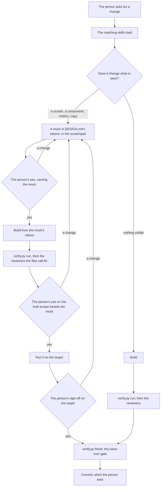

# The agent kit

What the skills and agents in this folder are, what each one is for, and how they work together on a change — in
plain words, for the person who owns the repo and anyone new to it. [AGENTS.md](../AGENTS.md) is where a coding agent
starts: the rules every change follows and a one-line index of everything here. Each skill's `SKILL.md` and each
agent's file hold the full description an agent matches against; [HARNESS.md](HARNESS.md) holds how changes are
guarded, checked and judged. Where this page and one of them disagree, they win — fix this page.

## Skills and agents

- **A skill is knowledge and procedure for one kind of change** — a screen, a token, a doc, a commit. It is a folder in
  `skills/` with a `SKILL.md`: when to use it, its rules (Do and Never), its steps, its checks and its traps, plus
  `scripts/` and `references/` where it needs them. A skill is loaded into the agent's own session when the task
  matches its description; it does nothing on its own.
- **An agent is a focused role with its own session** — a file in `agents/` that names the skills it loads, the tools
  it may use, the model and effort it runs on, and what it returns. The main session hands it a task and gets back its
  report. Builders make things; reviewers judge a diff, read-only; runners operate the target.
- **A reviewer scores against its rubric** — a file in `rubrics/`, one item per step of its review, plus items learned
  from what the person found on the target. It opens its report with `Verdict: pass | blocking`.
- **One file holds the design** — [`DESIGN.md`](../DESIGN.md) at the repo root: the principles and every token by
  role. The design skills and the `ui-designer` read it before any UI work, and the design check keeps it honest.
- **One file holds the project's facts** — [`project.py`](project.py): the checks, the judges' paths, the UI paths and
  the design gates, the secrets, the allowed hosts, the commands that ask. Every script reads it.

## How a change goes through the kit

The gates, the checks per path and what `finish` refuses: [HARNESS.md](HARNESS.md) §4, §5 and §9.

## What lives where

| Folder | Holds |
| --- | --- |
| [`project.py`](project.py) | The project's facts every script reads — the one file a project fills in |
| [`skills/`](skills/) | The 7 skills, each a `SKILL.md` with its `scripts/` |
| [`agents/`](agents/) | The 5 agents, one prompt each |
| [`rubrics/`](rubrics/) | What each reviewer scores |
| [`hooks/`](hooks/) | The guard before every tool call, and the injection flag after reading outside content |
| [`githooks/`](githooks/) | The pre-commit hook; CI runs the same rules on every push |
| [`evals/`](evals/) | `judgements.jsonl` — what each reviewer caught, missed or flagged wrongly, read by `verify.py calibration` |
| [`HARNESS.md`](HARNESS.md) | How agents are guarded, checked and judged here, and every point that needs the person |

`.claude/` links to `agents/` and `skills/`; `.codex/` names each agent for Codex.

## Skills

### Process — how any change is made, checked and handed over

| Skill | What it is for | Loaded by |
| --- | --- | --- |
| [`verify-change`](skills/verify-change/SKILL.md) | The loop every change runs: `verify.py` picks the checks and reviewers, records the person's approvals and the target, and refuses a hand-over while anything is open | Every session; the reviewers |
| [`build-run-test`](skills/build-run-test/SKILL.md) | Building, running, testing, screenshots; a fresh clone — filled in per project | `target-runner`, `ui-designer` |
| [`docs-authoring-and-sync`](skills/docs-authoring-and-sync/SKILL.md) | Writing docs and keeping them true to the code; the doc checks | `doc-reviewer`, `open-items-curator` |
| [`commit-message`](skills/commit-message/SKILL.md) | The repo's commit format, and stating honestly what was verified | — (loaded by task) |

### Design

| Skill | What it is for | Loaded by |
| --- | --- | --- |
| [`ui-designer`](skills/ui-designer/SKILL.md) | **Read first for any UI work.** The three gates — a mock, the built screen beside it, the target — and the review of a UI diff | `ui-designer` |
| [`accessibility`](skills/accessibility/SKILL.md) | Contrast against what is painted (`contrast.py`), focus and keyboard, names, target size, reduced motion | `ui-designer` |
| [`design-system`](skills/design-system/SKILL.md) | DESIGN.md — principles, tokens by role, themes, components, exceptions; the design check (`design_check.py`) and the token check (`token_check.py`) | `ui-designer` |

## Agents

### Builders — they make things, drafting for the person's yes first

| Agent | What it is for | Modes | Model / effort |
| --- | --- | --- | --- |
| [`ui-designer`](agents/ui-designer.md) | Screens, components, styles, motion and copy through the three gates, from DESIGN.md, accessibility first | mock, build, review | sonnet / high |

### Reviewers — read-only; each scores a diff against its rubric and returns a verdict

`verify.py run` names the ones a change's files call for ([HARNESS.md](HARNESS.md) §4).

| Agent | What it reviews | Model / effort |
| --- | --- | --- |
| [`code-reviewer`](agents/code-reviewer.md) | The code: correctness, the project's rules, coupled changes, what must never ship, docs in the same change | sonnet / high |
| [`doc-reviewer`](agents/doc-reviewer.md) | The docs: form against the guidelines, truth against the code | sonnet / medium |
| [`ui-designer`](agents/ui-designer.md) | UI and DESIGN.md, in review mode: the gates, accessibility, principles, tokens, components | sonnet / high |

### Runners — they operate the target, or tend the open items

| Agent | What it is for | Model / effort |
| --- | --- | --- |
| [`target-runner`](agents/target-runner.md) | Builds, runs the change on the target, takes screenshots and logs, and reports what it saw | haiku / low |
| [`open-items-curator`](agents/open-items-curator.md) | Matches the docs' open items against new results and proposes closing the answered ones; edits nothing | sonnet / medium |

Why each runs on the model it does: [HARNESS.md](HARNESS.md) §8.

## Keeping this page true

- **It follows the kit** — a skill or an agent added, renamed or removed changes its row here in the same change.
- **It says what each is for and holds no rule** — a rule lives once, in the skill, the agent, a rubric, the harness or
  a doc, and this page links to it.
- **"Loaded by" follows each agent's "Load first" list**; a skill no agent loads is still loaded by any session whose
  task matches its description.
