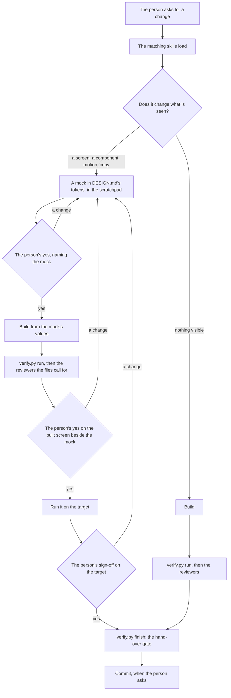

# The agent kit

What the skills and agents in this folder are, what each one is for, and how they work together on a change — in
plain words, for the person who owns the repo and anyone new to it. [AGENTS.md](../AGENTS.md) is where a coding agent
starts: the rules every change follows and a one-line index of everything here. Each skill's `SKILL.md` and each
agent's file hold the full description an agent matches against; [HARNESS.md](HARNESS.md) holds how changes are
guarded, checked and judged. Where this page and one of them disagree, they win — fix this page.

## Skills and agents

- **A skill is knowledge and procedure for one kind of change** — a screen, a token, a doc, a commit. It is a folder in
  `skills/` with a `SKILL.md`: when to use it, its rules (Do and Never), its steps, its checks and its traps, plus
  `scripts/` and `references/` where it needs them. A skill is loaded into the agent's own session when the task
  matches its description; it does nothing on its own.
- **An agent is a focused role with its own session** — a file in `agents/` that names the skills it loads, the tools
  it may use, the model and effort it runs on, and what it returns. The main session hands it a task and gets back its
  report. Builders make things; reviewers judge a diff, read-only; runners operate the target.
- **Every skill and agent carries a scope** — `portable` or `project`, in its frontmatter and in the tables
  below; what each means, and the check that holds them, is
  [AGENT_HARNESS §7.3](../docs/AGENT_HARNESS.md#73-the-harnesss-skills).
- **A reviewer scores against its rubric** — a file in `rubrics/` (the `ui-designer`'s items travel in its
  skill, `references/rubric.md`; its file here holds what this project learned), one item per step of its review, plus items learned
  from what the person found on the target. It opens its report with `Verdict: pass | blocking`.
- **Skills act on principles and industry standards, and adapt to any project** — WCAG, the platforms' design
  guidelines, MDN, published research. A design skill carries that knowledge in its `references/`, links nothing outside
  its folder, and works when copied into another repo; it never assumes this template's values.
- **One file holds the design** — [`DESIGN.md`](../DESIGN.md) at the repo root: the project's principles and every
  token by role. The one in this template is an example to replace. The design skills and the `ui-designer` read
  whatever brief the project has before any UI work, name its sections by what they hold, and the design check keeps
  it honest.
- **One file holds the project's facts** — [`project.py`](project.py): the checks, the judges' paths, the UI paths and
  the design gates, the secrets, the allowed hosts, the commands that ask. Every script reads it.

## How a change goes through the kit

The gates, the checks per path and what `finish` refuses: [HARNESS.md](HARNESS.md) §4, §5 and §9.

## What lives where

| Folder | Holds |
| --- | --- |
| [`project.py`](project.py) | The project's facts every script reads — the one file a project fills in |
| [`skills/`](skills/) | The 16 skills, each a `SKILL.md` with its `scripts/` |
| [`agents/`](agents/) | The 8 agents, one prompt each |
| [`rubrics/`](rubrics/) | What each reviewer scores |
| [`hooks/`](hooks/) | The guard before every tool call, and the injection flag after reading outside content |
| [`githooks/`](githooks/) | The pre-commit hook; CI runs the same rules on every push |
| [`evals/`](evals/) | `judgements.jsonl` — what each reviewer caught, missed or flagged wrongly, read by `verify.py calibration` |
| [`HARNESS.md`](HARNESS.md) | How agents are guarded, checked and judged here, and every point that needs the person |

`.claude/` links to `agents/` and `skills/`; `.codex/` names each agent for Codex.

## Skills

### Process — how any change is made, checked and handed over

| Skill | What it is for | Loaded by | Scope |
| --- | --- | --- | --- |
| [`verify-change`](skills/verify-change/SKILL.md) | The loop every change runs: `verify.py` picks the checks and reviewers, records the person's approvals and the target, and refuses a hand-over while anything is open | Every session; the reviewers | `project` |
| [`build-run-test`](skills/build-run-test/SKILL.md) | Building, running, testing, screenshots; a fresh clone — filled in per project | `target-runner`, `ui-designer` | `project` |
| [`docs-authoring-and-sync`](skills/docs-authoring-and-sync/SKILL.md) | Creating docs, writing them and keeping them true to the code. Portable: it carries the documentation guidelines (`references/guidelines.md`), a template per doc type, the scaffolder (`new_doc.py`) and the doc checks | `doc-writer`, `doc-reviewer`, `open-items-curator` | `portable` |
| [`commit-message`](skills/commit-message/SKILL.md) | The repo's commit format, and stating honestly what was verified | — (loaded by task) | `project` |

### Design

| Skill | What it is for | Loaded by | Scope |
| --- | --- | --- | --- |
| [`ui-designer`](skills/ui-designer/SKILL.md) | **Read first for any UI work.** The three gates — a draft, the built screen beside it, the target — each yes recorded against its file, and the review of a UI change. Portable: it carries the gates (`references/gates.md`) and records a yes by hand where `verify.py` is absent | `ui-designer` | `portable` |
| [`accessibility`](skills/accessibility/SKILL.md) | The WCAG 2.2 AA floors and how to meet and test each per platform: contrast against what is painted (`contrast.py`), focus and keyboard, names, target size, alternatives to gestures and hover, reduced motion, announcements, closed functionality on a device; the pattern check (`a11y_check.py`, web, native and C/C++ LVGL). Portable: it carries the criteria (`references/criteria.md`), so its folder works in any repo | `ui-designer` | `portable` |
| [`design-system`](skills/design-system/SKILL.md) | DESIGN.md — principles, tokens by role, themes, surfaces, layers, components, exceptions; the design check (`design_check.py`) and the token check (`token_check.py`), for CSS, native and C/C++ LVGL token files. Portable: it carries how a brief is written (`references/brief.md`) and a starter DESIGN.md, so its folder works in any repo | `ui-designer` | `portable` |
| [`motion`](skills/motion/SKILL.md) | Whether and how things move, the motion brief before a study, the debugging loop, the review of motion, a glossary, an LVGL panel's frame budget; the motion check (`motion_check.py`, web, native and C/C++ LVGL). Portable: it carries the principles (`references/motion.md`), and takes every value from the project's DESIGN.md | `ui-designer` | `portable` |
| [`touch-and-gesture`](skills/touch-and-gesture/SKILL.md) | Gestures, touch feedback, scroll-linked motion and layout, an encoder and buttons on a device; the gesture spec, the prototype on the device and the device walk; the touch check (`touch_check.py`, web, native and C/C++ LVGL). Portable: it carries the principles (`references/touch.md`), and takes every value from the project's DESIGN.md | `ui-designer` | `portable` |
| [`layout`](skills/layout/SKILL.md) | How screens are laid out and adapt: Bootstrap's breakpoint tiers on the window's width, never the device; the scaffold's regions, navigation and panes by tier; grids, containers, margins, spacing on a 4 or 8 base, density, content width; what survives a resize; watches and round or small panels; the same layout in web, iOS, Android and LVGL flex and grid words; the layout check (`layout_check.py`, web, native and C/C++ LVGL). Portable: it carries the principles (`references/layout.md`), and takes every value but the tiers from the project's DESIGN.md | `ui-designer` | `portable` |
| [`typography`](skills/typography/SKILL.md) | How type is applied from the project's own scale: six roles and what each is for, hierarchy, families and pairing, line height and spacing, the measure and alignment, emphasis, numbers, editorial treatments, text that scales, watches and LVGL's compiled fonts; the typography check (`typography_check.py`, web, native and C/C++ LVGL). Portable: it carries the principles (`references/typography.md`), and takes the scale from the project's DESIGN.md | `ui-designer` | `portable` |
| [`ux-designer`](skills/ux-designer/SKILL.md) | How an experience works: people, tasks, flows, structure, interaction models, states and errors, from HCI's heuristics, golden rules, interaction principles, Norman's principles and models, and every law on Laws of UX; research and evaluation methods; the UX brief the person approves before a new flow's mock. Portable: it carries the principles (`references/hci.md`), the methods (`references/methods.md`), the rubric and the brief template; no script | `ux-designer`, `ui-designer` | `portable` |
| [`esp-idf-setup`](skills/esp-idf-setup/SKILL.md) | An ESP-IDF firmware project from the hardware spec in `docs/`: the installed ESP-IDF, the spec and the questions that fill it, the project generated from the templates (`main`, `app_shell`, `app_hooks`, the board, LVGL on request), the layering check (`esp_idf.py`). Portable: it carries the principles (`references/esp-idf.md`) and the templates, and takes every fact from the project's spec | — | `portable` |
| [`react-vite-setup`](skills/react-vite-setup/SKILL.md) | A React, Vite and TypeScript web app from the web app spec in `docs/`: Node and Playwright's browsers checked, the spec written with a working app's defaults, the app generated from the templates (the shell, features, components with their stories, `tokens.css` from DESIGN.md, Vitest, Storybook and Playwright tests, CI), the layering check (`react_vite.py`). Portable: it carries the principles (`references/react-vite.md`) and the templates, and takes every fact from the project's spec and every value from its DESIGN.md | — | `portable` |
| [`ux-content`](skills/ux-content/SKILL.md) | The words on every screen: voice and tone, the four tests, mechanics, names, the pattern for each element, accessible content, strings ready for translation; the string check (`ux_lint.py`, web, iOS, Android and C/C++ LVGL). Portable: it carries the rules (`references/ux-content.md`), and takes the voice, case and word list from the project's DESIGN.md | `ui-designer`, `ux-content-writer` | `portable` |
| [`secrets-handling`](skills/secrets-handling/SKILL.md) | How the product takes, stores, shows, logs and rotates its users' secrets, per platform; bench and CI credentials; after a leak; the secret scan (`secret_scan.py`, counts only). Portable: it carries the rules (`references/secrets.md`); each project keeps its own secret inventory | — | `portable` |

## Agents

### Builders — they make things, drafting for the person's yes first

| Agent | What it is for | Modes | Model / effort | Scope |
| --- | --- | --- | --- | --- |
| [`ui-designer`](agents/ui-designer.md) | Screens, components, styles, motion and copy through the three gates, from DESIGN.md, accessibility first | mock, build, review | sonnet / high | `portable` |
| [`doc-writer`](agents/doc-writer.md) | Docs in `docs/`: a new doc scaffolded for its type, a new section, a rewrite — from verified facts and the person's answers | outline, write, rewrite | sonnet / medium | `portable` |
| [`ux-designer`](agents/ux-designer.md) | How an experience works: a UX brief for a new flow, feature or screen, a research plan, or a review of an experience scored X1–X14 — beside the `ui-designer`, which draws the screens. Portable: it needs the `ux-designer`, `accessibility` and `ux-content` skills | `portable` |
| [`ux-content-writer`](agents/ux-content-writer.md) | The words on screens: a string table for a screen or flow, a review of a diff's strings, the approved words applied — from the ux-content skill and the project's voice | write, review, rewrite | sonnet / medium | `portable` |

### Reviewers — read-only; each scores a diff against its rubric and returns a verdict

`verify.py run` names the ones a change's files call for ([HARNESS.md](HARNESS.md) §4).

| Agent | What it reviews | Model / effort | Scope |
| --- | --- | --- | --- |
| [`code-reviewer`](agents/code-reviewer.md) | The code: correctness, the project's rules, coupled changes, what must never ship, docs in the same change | sonnet / high | `project` |
| [`doc-reviewer`](agents/doc-reviewer.md) | The docs: form against the guidelines, truth against the code | sonnet / medium | `project` |
| [`ui-designer`](agents/ui-designer.md) | UI and DESIGN.md, in review mode: the gates, accessibility, principles, tokens, components | sonnet / high | `portable` |

### Runners — they operate the target, or tend the open items

| Agent | What it is for | Model / effort | Scope |
| --- | --- | --- | --- |
| [`target-runner`](agents/target-runner.md) | Builds, runs the change on the target, takes screenshots and logs, and reports what it saw | haiku / low | `project` |
| [`open-items-curator`](agents/open-items-curator.md) | Matches the docs' open items against new results and proposes closing the answered ones; edits nothing | sonnet / medium | `project` |

Why each runs on the model it does: [HARNESS.md](HARNESS.md) §8.

## Keeping this page true

- **It follows the kit** — a skill or an agent added, renamed or removed changes its row here in the same change.
- **It says what each is for and holds no rule** — a rule lives once, in the skill, the agent, a rubric, the harness or
  a doc, and this page links to it.
- **"Loaded by" follows each agent's "Load first" list**; a skill no agent loads is still loaded by any session whose
  task matches its description.
