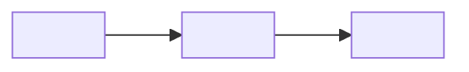

# {title}

{purpose} Source of truth: `<the code this doc explains — folders and entry points>`. Related: `<neighbouring docs>`.

---

## 1. The shape

`<One line: what the system is and the contract it keeps.>`

---

## 2. Rules

- **`<Rule>`** — `<reason>`.

---

## 3. How it works

`<Short paragraphs, each led by its point.>`

Where it lives: `<file>` — `<symbol>`.

---

## 4. Decisions

| Decision | Why | Alternatives that don't work, and why |
| --- | --- | --- |
| `<decision>` | `<reason>` | `<alternative>` — `<why it doesn't work>` |

---

## 5. Traps

- **`<Symptom>`** → `<cause>` → `<fix>`.

---

## 6. Open items

| Item | Status | Unblocked by |
| --- | --- | --- |
| `<question>` | Open | `<what would settle it>` |
