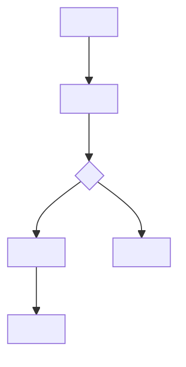

# UX brief — `<flow>`

`<flow>_ux<n>.md` — draft `<n>`. The person's yes names this file; a change is a new draft, `n + 1`.

## Outcome

- **Problem:** `<what is hard, slow or impossible today, for whom>`
- **Success:** `<how we will know — task success, time, a measure, a behaviour>`

## People and context

- **Who:** `<the people, or the persona>` — **job:** `<what they hire this for>`
- **Context:** `<where, how often, on what device and input — touch, keyboard, encoder and buttons, a watch>`
- **Evidence:** `<research this rests on>` or **assumption** `<what is assumed, and the research that would settle it>`

## Tasks

| Task | Frequency | Risk | Notes |
| --- | --- | --- | --- |
| `<top task>` | `<often / sometimes / rarely>` | `<low / high — what is lost if it goes wrong>` | |

## Flow

- **Entry points:** `<where people arrive from>`
- **Back and exit:** `<from every step>`

## Structure

- **Where it lives:** `<the place in the product, the navigation to it>`
- **Labels:** `<the names of things — the ux-content skill's rules>`

## Interaction model

- **Model:** `<direct manipulation / a form / a wizard / a command>` — because `<the task>`
- **Conceptual model:** `<one sentence: what the objects are and what can be done to them>`
- **Defaults:** `<what is prefilled or chosen, and why it is in the person's interest>`

## States

| State | What the person sees and can do |
| --- | --- |
| Empty | |
| Loading | |
| Partial | |
| Error | |
| Success | |
| Offline or unavailable | |

## Errors

- **Slips to prevent:** `<constraints, defaults, forgiving input>`
- **Mistakes to prevent:** `<conventions, previews>`
- **Undo:** `<what can be undone>` — **asks first:** `<only what cannot>`

## Principles applied

| Decision | Principle or law | Trade-off |
| --- | --- | --- |
| `<decision>` | `<HCI §n — heuristic or law>` | `<what it costs, if anything>` |

## Open questions

- `<question>` — options: `<a>` / `<b>` — settled by: `<method, people, tasks>`
