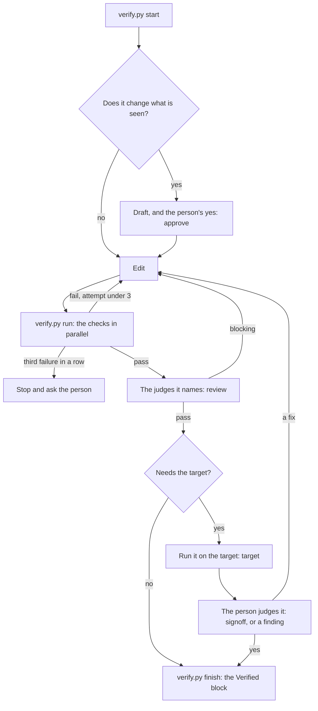

# Verify a change

The loop every change runs, from the first edit to the hand-over. The fixed part is a script anyone can run — an agent
or the person: [scripts/verify.py](scripts/verify.py). This skill is the judgment around it: which judge to ask, where
to stop for the person, what to do with what they saw. What runs for which files, what the gate refuses and every
point that needs the person: [HARNESS](../../HARNESS.md) §4, §5, §9. The generic design behind it:
[AGENT_HARNESS](../../../docs/AGENT_HARNESS.md) §9, §10, §20. The docs win if this skill and a doc disagree — fix the
skill.

## When to use

- A change starts: code, a screen, a style, copy, config, docs, or the kit itself.
- A change is done and about to be handed over or committed.
- A check fails twice — the third failure stops the loop.
- The person approves a draft, reports what the target showed, or disagrees with a judge.
- The agent learns something worth keeping mid-task: a trap it fell into, a step that misled, an approach that failed.

## Rules

### Do

1. **Start every task with `verify.py start "<task>"`** — the runs, reviews, approvals, target and failure count
   belong to one task (AGENT_HARNESS §10.1).
2. **Run the checks through `verify.py run`, not one by one** — it picks them from the touched files, runs them in
   parallel, records the run and counts failures (HARNESS §4).
3. **Stop at exit 3** — three failures in a row, runs or blocking reviews, mean the plan is wrong, not the last edit.
   Record the approach that failed and why (Recording what was learned), report each failure, and ask the person
   (AGENT_HARNESS §1, Do 6).
4. **Ask the judges `verify.py run` names, in parallel, and record each verdict with `verify.py review`.** A blocking
   verdict is a failed attempt; a pass stands until that judge's own files change — ask again only the judges
   `finish` names. Each judge scores its rubric in `.agents/rubrics/<judge>.md` and opens its report with
   `Verdict: pass | blocking`; that word is the one `review` records (AGENT_HARNESS §8, §9).
5. **Draft what the person must like before building it, and record their yes with `verify.py approve <file> --kind
   mock|motion|copy` the moment they give it, naming the file.** After the build, their yes on the built screen beside
   the mock is `--kind built`; after it runs on the target, their sign-off is `verify.py signoff "<what they judged>"`
   in their words. A change with no visible effect needs their word instead: `verify.py decision "no visible change:
   <why>"`; a design they handed over: `verify.py decision "design given: <where>"` (HARNESS §9; AGENT_HARNESS §20).
6. **Record the person's word with `verify.py decision`** the moment they decide something a judge may flag; every
   judge reads `status` first and does not block on it. A rule meant to last also goes into the doc that owns it.
7. **Treat a judge as evidence, not a verdict on its own** — a finding with no quoted line or output is unsure; read
   it yourself before acting.
8. **Run it on the target when the change needs it** — The target, below; "build only" from the person wins, and
   anything the guard asks about waits for their yes.
9. **Record every lesson with `verify.py finding`, routed** — what the person reports, and what the agent learned
   itself with `--source agent` (AGENT_HARNESS §9.2).
10. **Put a project lesson in the repo, never only in an agent's own memory** — per-user memory is one person's on one
    machine; the next agent and the judges never see it (AGENT_HARNESS §19).
11. **Hand over only when `verify.py finish` exits 0**, its Verified block filled in.
12. **Answer the stop reminder** — stopping on changes no run has seen, the Stop hook asks once: run `verify.py run`,
    or tell the person why not (HARNESS §10).

### Never

- **Run a check again unchanged after a failure** — change something first, or stop.
- **Keep going past exit 3** without the person.
- **Record a review the judge did not give, a yes the person did not say, or a target result nobody saw.**
- **Treat a request, a silence, a judge's pass or a check that passed as the person's yes.**
- **Put a token, a key, a password or a person's data in a finding** — `judgements.jsonl` is committed.

## Procedure

`V` is `python3 .agents/skills/verify-change/scripts/verify.py`, from the repo root.

### The loop

1. `V doctor` once per machine — the git hooks wired, the guard, the flag and the stop reminder in both adapters,
   their self-tests passing, Codex's hosts the project's.
2. `V start "<task in a few words>"`. A visible change: the draft and the person's yes come before the first edit —
   [`ui-designer`](../ui-designer/SKILL.md) gate 1; record it with `V approve <file> --kind mock`.
3. Edit. Then `V run`: each check's PASS or FAIL with the lines that matter, and the judges to ask.
   - exit 1: read the failing lines, fix, run again.
   - exit 3: stop — the retry limit (Do 3).
4. Ask each judge `V run` named, in parallel, with the diff; each returns its findings and a Verdict. Record each:
   `V review <judge> pass|blocking --note "<one line>"`. Blocking: fix and go back to step 3.
5. A visible change: show the person the built screen beside the approved mock ([`ui-designer`](../ui-designer/SKILL.md)
   gate 2); their yes: `V approve <side-by-side> --kind built`.
6. The change needs the target? The target, below; then `V target --where "<where>" --build "<which build>"
   --health-exit <n>`.
7. The person judges it on the target. Their yes: `V signoff "<what they judged>"`, in their words; what they report
   wrong, and what you learned, routed (Recording what was learned).
8. `V finish` — the Verified block's draft; exit 1 lists what is still open. On exit 0, fill in the `<…>` lines and
   hand over.

### The target

Where the change finally runs — `TARGET` in `.agents/project.py`: a browser on the dev server, a simulator, a device,
a preview deploy. The steps are the project's: [`build-run-test`](../build-run-test/SKILL.md) holds them, and the
[`target-runner`](../../agents/target-runner.md) agent runs them.

1. **Build** through the quiet wrapper — no warning the change introduced.
2. **Find the target, and check nothing else holds it** — a dev server already running on the port, a simulator
   another agent drives, a device in use. Busy: leave it alone and report it.
3. **Stop and ask instead** when the step needs anything the guard asks about or AGENTS.md → Safety lists: a deploy
   past preview, a migration, a paid API call, the person's accounts.
4. **Run it and take the evidence** — the health check, a screenshot of each changed screen at the sizes that
   matter, the console or log lines. Open each picture and say what it shows; a still frame cannot judge motion — that
   goes on the "Judge on the target" list.
5. **Clean up** — set any debug switch back, say what is left running.
6. **Record it** — `V target …`, then show the person.

### Recording what was learned

Every lesson leaves the task as something that catches it next time: what the person saw on the target, and what the
agent found out itself. Record each with `V finding "<what was seen or learned>" --route <route>`, adding `--source
agent` when the agent found it and, when a judge looked at that part, `--judge <judge> --caught yes|no`. A judge that
flagged something that was not a problem: `V dispute <judge> "<what>"`. Then make the edit the route names, in the
same change (AGENT_HARNESS §9.2).

| The lesson is | Route | Where it goes |
| --- | --- | --- |
| Checkable by a script or a test | `test` | A test case, or a check in `.agents/project.py` → `CHECKS` |
| Something a judge should have caught from the diff | `rubric` | A learned item in that judge's rubric |
| A command the guard let through or blocked wrongly | `guard` | A rule and a self-test case — `.agents/project.py` → `ASK_COMMANDS` and `GUARD_CASES`, or the guard — with a near-miss that must pass |
| A step that misled, a trap in how a task is done | `skill` | That skill's Never or Traps, citing the doc § that holds the reason |
| Settled and true of the product or the code | `doc` | The owning doc: a rule, a Never, a trap, a Decision ([`docs-authoring-and-sync`](../docs-authoring-and-sync/SKILL.md)) |
| Seen once, not yet measured or explained | `open-item` | The owning doc's open items ([`open-items-curator`](../../agents/open-items-curator.md)) |
| Only the target will ever show it | `none` | The Verified block's "Judge on the target" |

- **A `rubric` lesson is a learned item in that judge's Learned table**, added in the change that records the finding:
  `L<n>`, the next free number, never reused; the date; what the person saw, in a few words and no secret; and what in
  a diff predicts it — a symbol, a value, a missing companion change the judge can quote, not the symptom. **Promote**
  it to a check once a script can find it; **fold** it into its R-item once the owning doc states the rule; **retire**
  it when the code it guarded is gone; after a false alarm, **narrow** its "Looks for" (AGENT_HARNESS §9.3).
- **An anti-pattern goes where the mistake would be made** — a product or code mistake in the doc that owns the
  topic, with the skill's one-line Never citing it; a workflow mistake in the skill; a command in the guard.
- **A failed approach is recorded at exit 3** with `V finding "<approach, why it failed>" --source agent --route
  doc|skill|open-item` — the task's most useful lesson, and the one the chat loses first.
- `V calibration` shows, per judge, what it caught, missed and raised in error; the findings only the person could
  see; the count per route.

### State

`.cache/harness/` (git-ignored): `task.json` — the task, runs, reviews, approvals with each file's hash, decisions,
the target and the sign-offs, findings, failures in a row; `nudged` — the tree the stop reminder last asked about;
`runs/<n>/` — each check's log; `logs/` — the quiet wrapper's logs; `history/` — earlier tasks. Read `V status`
instead of searching the chat for where the task stands.

## Checks

- [ ] (script) `V doctor` prints `doctor: OK`
- [ ] (script) `V run` exits 0 on the final tree
- [ ] Every judge `V run` named has a recorded pass on the final tree
- [ ] Every yes the person gave is recorded with `V approve` or `V signoff`, on the file they named
- [ ] Every finding the person reported, and every lesson the agent learned, is recorded and routed, and the edit its
  route names is in the change
- [ ] (script) `V finish` exits 0, and its Verified block is filled in

## Traps

- **`V finish`: "the tree changed after the last run"** → an edit after the last `V run`, even a doc fix → run again;
  "reviewed an older version of its files" → a file that judge reads changed since its pass → ask that judge again,
  only that one.
- **`V status`: "the file changed since the yes"** → the approved mock was redrawn → show the person the new file; the
  old yes does not cover it.
- **`V finish`: "came after the first run that built it"** → the mock was approved once the code was already built →
  the draft comes first: show it, take the yes, and rebuild from its values.
- **`V finish`: "the code changed after the person's yes"** → an edit to a screen after they approved it built → show
  them again.
- **`V finish`: "no sign-off from the person on the target"** → it ran there and they have not judged it, or the code
  changed after their yes → run it again, `V target`, show them, and record their words with `V signoff`.
- **A fix reported as done is not in the files** → it was chained with `&&` after `V review <judge> blocking`, which
  exits 1 (a failed attempt), so the edit never ran → record the verdict as its own step, make each edit as its own
  step, and grep that it landed before saying it is fixed.
- **The guard blocks a command the task needs** → it is a rule from AGENTS.md → ask the person to run or approve it;
  never rephrase the command to get past it.
- **`V run` names no checks** → nothing differs from `HEAD`, or only files no check covers → the change is committed
  or not saved, or needs its own check in `.agents/project.py`.
- **A project check fails with "not found"** → its program is not installed on this machine → install it, or ask the
  person; `V doctor` lists each check's program.

## Sources

| Topic | Where |
| --- | --- |
| Checks and judges by path, the hand-over gate, the person in the loop | [HARNESS §4, §5, §9](../../HARNESS.md#4-checks-and-judges-by-path) |
| The guard, the hooks, the adapters, each agent's model | [HARNESS §2, §3, §7, §8](../../HARNESS.md#2-the-guard) |
| The loop's design: commands, exit codes, task state, the hand-over | [AGENT_HARNESS §10](../../../docs/AGENT_HARNESS.md#10-the-verify-loop) |
| Rubrics, learned items, routes, calibration | [AGENT_HARNESS §9](../../../docs/AGENT_HARNESS.md#9-rubrics-learnings-and-calibration) |
| The person in the loop, approval before building | [AGENT_HARNESS §20](../../../docs/AGENT_HARNESS.md#20-human-in-the-loop) |
| Build, run, the target's steps | [`build-run-test`](../build-run-test/SKILL.md) |
| Doc checks | [`docs-authoring-and-sync`](../docs-authoring-and-sync/SKILL.md) |
