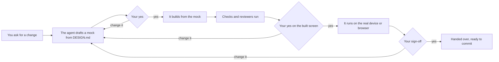

# Designers' Agent Harness

A starter template and a guide for working with coding agents — Claude Code, Codex, Cursor, Copilot — on a new
product, written for designers and the developers they work with. It works for any stack: a web app, a mobile app, a
design system, a service. Start a project from this template and the agent works inside a harness from the first
commit: it reads the house rules, drafts before it builds, runs the checks, asks before anything risky, and hands over
only when the work is checked and you have signed off.

---

## What is an agent harness?

A coding agent is a model that reads and edits your repo. It is fast and tireless, but it forgets everything between
conversations, it sometimes misreads a brief, and it will happily build something you never agreed to. **A harness is
everything around the agent that is not the model** — the studio process that makes its work reliable:

| Part | In studio terms | Here |
| --- | --- | --- |
| The brief | What everyone reads before starting | `AGENTS.md` — the rules for every change, and a map of the repo |
| The design brief | The principles and the style guide | `DESIGN.md` — the product's principles and every design token, per theme |
| Playbooks | How each kind of job is done here | Skills in `.agents/skills/` — `ui-designer`, `accessibility`, `design-system`, … |
| Sketch first | The client sees a sketch before anything is built | The design gates: a mock, your yes, then the build |
| The checklist | Steps that run themselves | `verify.py` — picks and runs the checks a change needs |
| Reviewers | A second pair of eyes against the house rules | Read-only judge agents, each scoring a rubric |
| Locks on the doors | Some things need the owner | The guard — asks before a commit, a push, a delete, a deploy; never lets the agent read your secrets |
| The notebook | What was learned stays learned | Docs, rubrics and a judgements log in the repo — not in one chat |



The full guide — what each part is, how it works, and why it is built that way — is
[docs/AGENT_HARNESS.md](docs/AGENT_HARNESS.md). §22 walks one design change through every step.

---

## Quick start

You need git, Python 3.9 or newer (macOS ships it), and a coding agent: Claude Code or Codex run the hooks; other agents
get the rules, the skills and the commit gate.

1. **Make your project from this template** — "Use this template" on GitHub, or copy every file here, the hidden ones
   included (`.agents/`, `.claude/`, `.codex/`, `.github/`), into your new repo.
2. **Wire the commit gate**, once per clone — the agent is not allowed to do this for you:

   ```sh
   git config core.hooksPath .agents/githooks
   python3 .agents/skills/verify-change/scripts/verify.py doctor
   ```

   `doctor` lists what is wired and what is still a placeholder.
3. **Open the repo in your coding agent** and approve its hooks when it asks (Claude Code: `/hooks`; Codex: trust the
   project).
4. **Make [DESIGN.md](DESIGN.md) yours** — it ships as a demo: five principles and a full token set in light and
   dark, every contrast pair passing. Replace the principles and values with your product's, keeping its table
   shapes; the design check proves your contrast pairs and, once you point it at your token files, that the code
   carries every token. The bootstrap prompt can draft it with you from your design file.
5. **Run the bootstrap prompt** — copy it from [docs/AGENT_HARNESS.md §17.1](docs/AGENT_HARNESS.md#171-the-prompt),
   fill in "About the project", and paste it to the agent. It fills in `.agents/project.py`, `AGENTS.md` and the
   project's skills, and stops for you after each phase.
6. **Ask for your first design change.** The agent drafts a mock and stops; say yes by name ("yes to mock 2"), and it
   builds.

### What you approve, and how

| You say | The agent records | Why it matters |
| --- | --- | --- |
| "Yes to `settings_mock2.png`" | `verify.py approve settings_mock2.png --kind mock` | The yes covers exactly that file; a redrawn mock needs a new yes |
| "Yes to the new type scale" on a specimen | `verify.py approve type_specimen.png --kind mock`, before `DESIGN.md`'s values reach the code | A token is seen on every screen at once |
| "Yes" to the built screen beside the mock | `verify.py approve <side-by-side> --kind built` | The build matches what you agreed |
| "Feels right on the phone" | `verify.py signoff "feels right on the phone"` | Only you can judge feel, motion and words on the real thing |
| "I gave you the design in the file" | `verify.py decision "design given: <where>"` | Your design is the approved draft |
| "This is a refactor, nothing visible" | `verify.py decision "no visible change: <why>"` | No mock needed |

The agent cannot hand over while a yes is missing: `verify.py finish` refuses.

---

## What is in the template

| Path | Holds | You fill in |
| --- | --- | --- |
| [AGENTS.md](AGENTS.md) | The brief every agent loads first | The `<…>` placeholders — the bootstrap prompt does it |
| [DESIGN.md](DESIGN.md) | The design brief: principles, colour roles per theme, contrast pairs, type, space, radius, motion, layout, components, exceptions | Your principles and values over the demo's |
| [.agents/project.py](.agents/project.py) | The one settings file: checks, UI paths, the design brief and token files, secrets, allowed hosts, commands that ask | Every list — commented examples for web, mobile and Python |
| [.agents/README.md](.agents/README.md) | The kit in plain words: each skill and agent, what it is for | — |
| [.agents/HARNESS.md](.agents/HARNESS.md) | This repo's policy, case by case | The project's rows |
| [.agents/skills/](.agents/skills/) | 7 skills — the loop, docs, commits, UI design, accessibility, design tokens, build and run. The docs skill is portable: it carries the documentation guidelines, a template per doc type and a doc scaffolder, so its folder works in any repo | `build-run-test` |
| [.agents/agents/](.agents/agents/) | 6 agents — `ui-designer`, `doc-writer`, `code-reviewer`, `doc-reviewer`, `target-runner`, `open-items-curator` | — |
| [.agents/rubrics/](.agents/rubrics/) | What each reviewer scores; grows as you report what they missed | — |
| `.agents/hooks/` | The guard and the injection flag, with self-tests | — |
| `.agents/githooks/pre-commit` | Refuses a commit with a secret, a build file or a debug line | — |
| `.claude/`, `.codex/` | Adapters for Claude Code and Codex: hooks, read denies, sandbox | Read denies for your secret files |
| `.github/workflows/checks.yml` | CI: the commit rules on every push | Your build and tests, as more jobs |
| [docs/](docs/) | The knowledge: the two guides, then your product's docs | Your design tokens, components, architecture |

Everything is plain files and Python's standard library: no package to install, nothing that phones home.

---

## Documentation

| Doc | What it holds |
| --- | --- |
| [AGENT_HARNESS](docs/AGENT_HARNESS.md) | What an agent harness is and how each part works — the rules, the loop, the guard, the reviewers, the design gates, memory, token use, and the bootstrap prompt. Generic: any project, any stack |
| [DESIGN](DESIGN.md) | The product's design brief — principles and tokens. A demo until you write yours; AGENT_HARNESS §23 explains how agents use it |
| [DOCUMENTATION_GUIDELINES](.agents/skills/docs-authoring-and-sync/references/guidelines.md) | How every doc is written and kept true, so an agent finds what it needs. Generic: any project, any stack |

The kit's own pages: [.agents/README.md](.agents/README.md) (the skills and agents in plain words) and
[.agents/HARNESS.md](.agents/HARNESS.md) (this repo's policy, case by case).

---

## License

MIT — see [LICENSE](LICENSE).
