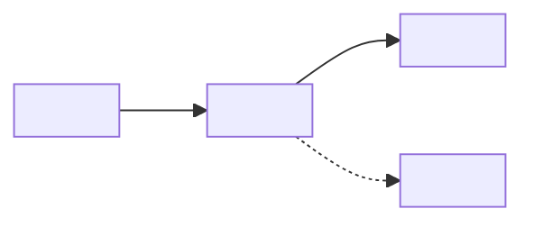

# Documentation Guidelines

How to write, restructure, and maintain **every doc in `docs/`** of a project, whatever it is built with — a web app,
a mobile app, a design system, a service, a library, firmware. The goal is **complete and scannable**: everything a
designer or developer needs is written down, and a coding agent finds it without reading the whole doc. Shorter is
not the goal — findable is.

These guidelines are product-neutral. A project fills in two names once: its **doc prefix** (`<PREFIX>`, a short code
for the product) and its **project name** (`<Project>`, used in titles). In a repo built from the agent-harness
template both live in `.agents/project.py` (`DOC_PREFIX`, `PROJECT_NAME`), where the doc checks read them.

**Related.** [AGENT_HARNESS](AGENT_HARNESS.md) — the harness these guidelines are part of: knowledge in docs, workflow
in the kit (§1). Its docs-authoring skill applies these rules on every doc change and holds the steps and checks they
point to.

**Stability.** Cite this doc as `DOCUMENTATION_GUIDELINES §n`, or `GUIDELINES §n` for short. Do not renumber; add new
material under the next free number.

| § | Section | Look here for |
| --- | --- | --- |
| 1 | [Principles](#1-principles) | What docs are for; knowledge in docs, workflow in the kit; what counts as documentation |
| 2 | [Doc types](#2-doc-types) | Which kind of doc you're writing and what it opens with |
| 3 | [Structure](#3-structure) | Naming, opening block, section building blocks, numbering, contents table, writing a section |
| 4 | [Content](#4-content) | What to capture; rationale, history, values, sources and tags; what may be removed; the facts every project records |
| 5 | [Writing style](#5-writing-style) | Bullets, prose, terminology |
| 6 | [Markdown mechanics](#6-markdown-mechanics) | Tables, code blocks, links, banners, tags, lint, Mermaid diagrams |
| 7 | [Keeping docs true](#7-keeping-docs-true) | Verifying against code, tokens and config, inbound links, README |
| 8 | [Rewriting an existing doc](#8-rewriting-an-existing-doc) | The rules that keep a rewrite from losing information |
| 9 | [Length and splitting](#9-length-and-splitting) | No length limit; signals to restructure, when to split, how to measure |
| 10 | [Template](#10-template) | Copyable skeleton |
| 11 | [Pre-commit checklist](#11-pre-commit-checklist) | Where the last pass before committing a doc lives |

---

## 1. Principles

1. **Docs hold the knowledge; code holds the implementation; the agent kit holds the workflow.** Anything someone
   needs to understand, change, or avoid breaking the product is written in a doc: constraints, decisions and their
   reasons, alternatives that don't work, measurements, traps. **Never leave it only in code comments, config
   comments, commit history, a design file or a skill.**
2. **Docs describe the repo as it is now.** No changelogs, investigation narratives, or status of finished work — git
   holds history. A doc is a specification, not a notepad (§4.3).
3. **Optimize, don't minimize.** Restructure, deduplicate, and tighten wording. Remove only what §4.6 allows: what is
   wrong, obsolete, history, repeated, filler, or belongs in another doc or the kit.
4. **Scannable means findable.** Predictable structure, headings with the words people search for, rules separated
   from their reasons, tables for anything looked up.
5. **Docs and code agree.** Docs restate values from code, tokens and config where that helps the reader, and every
   restated value is kept in sync (§7). A disagreement is a bug: find out which side is intended before changing
   either.
6. **Write for a coding agent making a change.** It arrives through search or the contents table, reads one section,
   and acts on it. People benefit from the same properties.
7. **Workflow lives in the agent kit, not in docs.** Step-by-step procedures, command recipes (build, run, deploy,
   release), checklists, review walks, script checks and agent prompts live in a skill or agent in the project's
   agent kit (`.agents/skills/<skill>/SKILL.md`, indexed from `AGENTS.md`). The doc keeps every rule and reason those
   steps follow — what must hold, what order matters and why — and links the skill. A skill condenses a doc in
   one-line rules that cite `DOC §n`; it never copies a doc's sections, and a doc never copies a skill's steps. Each
   fact has one home.
   - Why: the same checklist kept in a doc and a skill drifts apart, and a reader cannot tell which copy is current; a
     doc full of step lists hides the facts the steps rest on.
   - A project without an agent kit yet still keeps procedures out of docs: put them in the skill file that will
     become the kit, and link it.
8. **Documentation is `docs/`, the design brief, and the rules kept in the kit.** `docs/` holds what the product is and
   how it works; `DESIGN.md` at the root holds what it should look and feel like (§3.1); the kit holds what an agent
   applies while doing a task — the harness's own policy (`.agents/HARNESS.md`) and any rules a skill keeps in its
   `references/` — and docs cite those as they cite a doc (`DESIGN §n`, `HARNESS §n`). Material fed in from outside for
   one session — chat logs, private notes, a vendor's email — is not documentation: no doc, skill, agent or code comment
   cites it, and a fact a reader needs from it is written into the doc that owns the topic. Design files, platform
   specifications, vendor API docs and research findings are **sources**, cited with a tag (§4.5), not documentation.

---

## 2. Doc types

| Type | Typical docs | Opens with | Must also contain |
| --- | --- | --- | --- |
| Rules and reference | `DESIGN.md` (the design brief), `UI_GUIDELINES`, `CONTENT_STYLE`, `CODING_CONVENTIONS`, `DOCUMENTATION_GUIDELINES` | Rules (Do / Never) | Task lookup, reference tables, traps, exceptions, the reason behind each rule |
| Interface | `PLATFORM_SPECS` (screen sizes, devices, browsers), `API` (an external service's contract), `HARDWARE_SPECS` | Critical constraints | Tables of values with their sources; stable `§n` cited from code |
| System explanation | `APP_ARCHITECTURE`, `NAVIGATION`, `DATA_MODEL`, `STATE_AND_STORAGE`, `AUTH`, `OFFLINE`, `NOTIFICATIONS` | The shape of the system and its contracts | How it works, decisions and the alternatives that don't work, measurements, traps |
| Configuration | `CONFIG` (environment settings, feature flags, build settings, dependency versions) | The settings that matter | The reason for every non-default setting |
| Working notes | `OPEN_ITEMS` | Open items, grouped by what unblocks them | Status per item, and the findings an open item still needs. Open items only: when one closes, its outcome moves into the doc that owns the topic and the item is deleted (§4.3) |
| Requirements | `<FEATURE>_REQUIREMENTS` | Status banner | Requirements, conflicts with today's design, what to measure or test first |

A doc that mixes types opens with the type most readers come for.

---

## 3. Structure

### 3.1 Naming

- **A project doc** is `docs/<PREFIX>_<TOPIC>.md`, titled `# <Project> — <Topic>`. `<TOPIC>` is upper snake case
  (`DATA_MODEL`); `<Topic>` is the same words in title case (`Data Model`). Use one `<PREFIX>` for every doc in
  the repo, or none at all.
- **A project-wide doc drops the prefix**: `docs/<TOPIC>.md`, titled `# <Topic>`. It applies to any repo and any
  product — these guidelines, the agent-harness guide — so it names no project and links only to the other
  project-wide docs beside it. What this repo does with it goes in a project doc that links to it; the project-wide
  doc never links back.
- **The design brief is `DESIGN.md` at the repo root**, titled `# <Project> — Design`, beside `README.md` and
  `AGENTS.md`: people and agents look for it there by name. It holds the product's principles and every design token
  by role with its value per theme, follows these guidelines like any doc, and is cited `DESIGN §n`.
- Renaming an existing doc or its title changes links — check inbound links first (§7).

### 3.2 Opening block

Every doc starts with these, in order. Omit an item only when it doesn't apply.

| Item | Form | Example |
| --- | --- | --- |
| Title | `# <Project> — <Topic>` | |
| Status banner | Blockquote with a bold status, when the doc isn't a normal spec | `> **STATUS: NOT IMPLEMENTED.**` · `> **STATUS: PARKED.**` · `**Working document.**` |
| Purpose | 1–4 lines: what it covers and who needs it | |
| Source of truth | The files, tokens, design files or specifications it describes; which wins where two overlap | "The token files win for values, the design file for intent, this doc for the reason" |
| Related docs | Links to neighbours, with what each holds | |
| Stability note | When code comments or the kit cite its `§n` | "Do not renumber" |
| Legend | Every tag the doc uses | `[SPEC]` = from the platform's specification |
| Contents table | `§ \| Section \| Look here for`, when the doc is over ~150 lines — rules in §3.5 | This doc |

### 3.3 Section building blocks

Pick the blocks a doc needs and keep them in this order. **Omit empty blocks** — no "None" or "TBD" placeholders.

| Block | Holds | Example |
| --- | --- | --- |
| Rules / critical constraints | What must and must not happen — the one home for each rule | "Never put text under 4.5:1 against what is painted behind it" |
| Task lookup | `I need to… \| Use \| Notes` → component, token, function, file or setting | "Show a non-blocking message → `Toast`" |
| Traps | Anything that fails silently or misleads: symptom → cause → fix | "Dark mode looks muddy → the theme swapped scale steps, not roles → define each role's dark value" |
| How it works | Explanation, pipelines, contracts; a Mermaid diagram for any flow (§6.1) | Request → cache → API → screen |
| Reference tables | Values readers choose from or look up: scales, breakpoints, settings, constants, routes | The spacing scale; the breakpoint table |
| Decisions | Decision, why, alternatives that don't work and why | "Why tokens by role, not by value" |
| Measurements | Value, conditions (§4.5), source | Time to first screen on a mid-range phone |
| Exceptions | `Value \| Where \| Reason` register for departures from the doc's rules | A one-off colour on the marketing hero |
| Open items | Status, what unblocks it | "Reduced-motion behaviour of the onboarding — needs a test on the device" |
| Cross-references | Where related topics live | Links to neighbouring docs and source files |

- **Procedures and checklists are not doc blocks** (§1, Principle 7). Their steps live in the skill that runs them;
  the doc keeps the rules and reasons each step rests on, in the blocks above, and links the skill —
  `Steps: the <skill> skill (.agents/skills/<skill>/SKILL.md).`
- **A section a procedure or checklist used to fill keeps its number** as a one-line pointer to the skill, so cited
  `§n` still resolve (§3.4).

### 3.4 Numbering and headings

- **Number sections** (`## 1.`, `### 1.1`) so docs, the kit and code comments can cite `§n`.
- **Numbers run in order, without gaps or duplicates.** Don't split one section across two headings ("— continued").
- **Add material under the next free number instead of renumbering.** If a renumber is unavoidable, update every
  inbound `§n` in the same change (§7).
- **Headings use the words a reader searches for**: "Tap target size", not "Easy to hit".
- **An open item's status goes in its heading or table row**: `— PARKED`. Closed items leave the doc (§4.3).
- Separate top-level sections with `---`.

### 3.5 Contents table

- **Add a contents table when a doc is over ~150 lines.** Place it at the end of the opening block, before the first
  `---`.
- **Use exactly three columns**: `| § | Section | Look here for |`.

| Column | Contents |
| --- | --- |
| `§` | The section number. `—` for an unnumbered section, such as Quick rules |
| Section | A link to the heading: `[Doc types](#2-doc-types)`. Link text is the heading without its number |
| Look here for | What a reader comes to the section to find — short noun phrases separated by commas or semicolons. Don't restate the heading |

- **List every `##` section, in document order.** In a doc over ~1,000 lines, also list the `###` subsections readers
  jump to directly, numbered `3.3`.
- **Anchors follow GitHub's heading slugs**: lowercase; spaces become `-`; punctuation other than `-` and `_` is
  dropped, backticks too (`## 3. The list and app_routes` → `#3-the-list-and-app_routes`). `## 9. Type (body and
  display)` → `#9-type-body-and-display`. A dropped character between two spaces leaves a double hyphen:
  `### 3.1 Space — padding` → `#31-space--padding`, `## 4. Tokens & themes` → `#4-tokens--themes`.
- **Update the table in the same change as any heading edit.** The docs-authoring skill's anchors check proves every
  link resolves.

### 3.6 Writing a section

A reader — usually a coding agent — lands in one section from search and reads only that section.

- **Make it self-contained.** Name components, tokens, files and settings in full, and link terms defined elsewhere
  (`see §2.3`). Never "as above" or "the earlier table".
- **Answer first.** The first line says what the section decides or holds; details follow.
- **One topic per section.** The heading's scope matches the content; a second topic gets its own section.
- **Order the inside consistently**, skipping parts that don't apply:
  1. What the section decides or holds — one line
  2. Rules or the answer
  3. Why
  4. Details: values, tables, diagram
  5. Example
  6. Where it lives — file and symbol
  7. Related sections and docs — links, not summaries
- **Add a subsection** when the topic shifts, a second lookup table appears, or the section passes ~600 words (§9).
- **Heading depth**: `##` for sections, `###` for subsections, `####` only when unavoidable — never deeper.

```markdown
## 4. <Topic>

<One line: what this section decides or holds.>

- **<Rule>** — <reason>.

| <Key> | <Value> | <Use> |
| --- | --- | --- |

Where it lives: [`<file>`](../src/<path>/<file>) — `<symbol>`.

Related: §2, [<doc>](<PREFIX>_<DOC>.md).
```

---

## 4. Content

### 4.1 What to capture

For its topic, a doc captures:

- Constraints, and what breaks if they're violated
- Decisions and their reasons, including alternatives that don't work and why
- Measurements, with their conditions (§4.5) and source
- What a procedure must respect — the constraint, the order that matters and why — with a link to the skill that
  holds its steps (§1, Principle 7)
- Traps — anything that fails silently or misleads
- Approved exceptions to the doc's own rules
- Pointers into the code: file and symbol, the token, and the setting where behaviour is configurable
- Open questions and what would answer them

### 4.2 Rationale — keep it, place it

- **Separate the rule from its reason.** State the rule in one line. Put the reason right after it — an inline clause
  when short, a `Why:` sub-bullet when longer — or in a Decisions table or subsection. Never bury a rule
  mid-paragraph.
- **Keep every reason that stops someone reintroducing a known failure**, however long. Tighten the wording, not the
  substance.
- **A code comment can hold the full argument at the declaration; the doc still holds the decision and its reason.**
  Link the file and symbol.

### 4.3 Current state, not history

- **Describe the repo as it is now.** No changelogs, no investigation narratives, no dated status of finished work.
  Git holds history.
- **Keep the reason, drop the story.** Restate what was learned as a present-tense rule or reason: "Body text is
  17 px — at 15 px testers missed the second line on a phone", not "Body text was 15 px until…".
- **When an open item closes, write its outcome into the doc that owns the topic as current fact**, then delete the
  item. The outcome is every fact, measurement, reason and trap the item established — a finding that stops someone
  repeating a mistake goes in as a rule or a trap. The narrative of how it was found is dropped. This holds for working
  notes too: they keep no closed items.
- **Avoid history words**: *used to*, *was*, *former*, *originally*, *until recently*, *closed on*.

### 4.4 Values from code, tokens and config

- **Restate values when they help a reader choose, understand, or check** — token scales, breakpoints, timing
  constants, settings, routes. Name the token, symbol or setting and link the file.
- **Keep restated tables complete** and update them in the same change as the code (§7).
- **Cite the file a person edits, not a generated one**: the token source, not the built CSS; the manifest
  (`package.json`, `pyproject.toml`) for the declared version range, the lock file for the resolved one.

### 4.5 Sources and confidence

- **Say where every figure comes from.** Tag values from a specification, give measured values their conditions and
  date, and label derived or assumed values. Define every tag a doc uses in its legend.
- **Common tags** — define the ones a doc uses:

| Tag | Source |
| --- | --- |
| `[SPEC]` | A platform's or standard's specification — WCAG, a platform's design guidelines, an RFC, a datasheet |
| `[API]` | A vendor's API or SDK documentation |
| `[DES]` | The design source — the design file, frame or component named beside it |
| `[RES]` | User research — the study and its date |
| `[M]` | Measured in this project — with its date and conditions |
| `[EX]` | An example or vendor code validated in this project |
| `[D]` | Derived — calculated from cited values, not measured |
| `[?]` | Unverified — tracked as an open item |

- **Measurement conditions**: the build (debug or release) and the commit, the device or browser and its version, the
  OS, the network, the data set, how it was measured (a profiler, a stopwatch, an analytics query) and how many runs.
- **Mark anything unverified** (`[?]`, "unverified") and track it as an open item.
- **A tuned constant's comment carries its method, date and value** — `// <value>: <how measured>, <date>,
  <conditions>, <runs>` — not "placeholder" or "feels right". A value nobody has measured says so (`[?]`,
  unverified) and has an open item. A comment that reads as derived invites the next person's arithmetic to replace a
  measured value; one that names its measurement does not.

### 4.6 What may be removed

| Remove | Instead |
| --- | --- |
| A wrong fact | Fix it. If the mistake is easy to repeat, add the correct rule or a trap |
| Content about code or a design that is gone | Delete it. If it explains a current constraint, restate that as a present-tense reason |
| History: changelogs, investigation narratives, dated status of finished work | Delete it; git holds it. Keep any current fact or reason it established |
| A repeat of something elsewhere in the same doc | Keep one copy; link to it |
| Filler words | Delete them |
| Content that belongs in another doc | Move it there and link from where it was |
| A procedure, checklist, command recipe or agent prompt | Move it to the skill or agent that runs it; keep each rule and reason it rests on in the doc, and link the skill (§1, Principle 7) |
| A fact repeated in another doc | Keep it in the doc that owns the topic; link to it from the other (§5) |

Nothing else is removed. Length alone is never a reason (§9).

### 4.7 Project facts

The facts every project's docs must hold somewhere, and the doc type that usually owns each (§2). A fact that does not
apply to the product is skipped; one that does is never left only in code or a design file.

| Fact | Usually owned by |
| --- | --- |
| Target platforms, devices, browsers and screen sizes, with the oldest supported version of each | Interface |
| Toolchain and runtime versions; each pinned dependency and why it is pinned | Configuration |
| Every non-default setting and feature flag, with its reason | Configuration |
| Design principles; design tokens: each scale, each role and its value per theme, the contrast pairs, and every exception | The design brief, `DESIGN.md` |
| Components: what each is for, its states, and when not to use it | The design brief, `DESIGN.md` |
| Accessibility floors the product meets, and any it exceeds | Rules and reference |
| Navigation: the screens, how each is reached, and what back does | System explanation |
| Data: what is stored, where, for how long, and what clearing it loses | System explanation |
| External services: what is called, its limits, and what happens when it fails | System explanation |
| Startup order and what each step waits for | System explanation |

---

## 5. Writing style

- **One fact per bullet.** Lead with the rule or finding in bold; follow with the reason.
- **Imperative, present tense for rules**: "Take every colour from a token", not "it is recommended to use tokens".
- **Prose is for explanation** — How it works, Decisions. Keep paragraphs short and put the point in the first
  sentence.
- **Each rule has one home per doc.** Elsewhere in that doc, link to it (`see §2.3`). Across docs, one doc owns a topic
  and the others link to it.
- **Name the thing, not a description of it**: `color.text.secondary`, not "the grey text colour"; `SettingsRow`, not
  "the row component".
- **One term per concept, used everywhere.** Define it once where it first matters — for example **sheet**, never also
  "drawer" or "panel"; **token**, never also "variable".
- **Every number carries its unit**: `16 px`, `44 pt`, `48 dp`, `300 ms`, `4.5:1`, `2 MB`, `60 fps`.
- **Cut filler**: *note that*, *it's worth mentioning*, *in order to*, *simply*, *basically*.

---

## 6. Markdown mechanics

| Element | Rule |
| --- | --- |
| Headings | `#` syntax only — never a bold paragraph as a heading (lint MD036) |
| Code blocks | Always tag the language: `ts`, `js`, `css`, `json`, `yaml`, `swift`, `kotlin`, `python`, `sh`, `text` (lint MD040) |
| Tables | For any item with 2+ attributes. Keep cells short; a long reason goes in a bullet below |
| Identifiers | Backticks for tokens, components, symbols, files, settings and literal values |
| Repo links | Relative: `[tokens.css](../src/styles/tokens.css)` |
| Line references | **File + symbol, not line numbers** — line numbers drift |
| Status banners | Blockquote at the top: `> **STATUS: …**` |
| Callouts | `> [!IMPORTANT]` for a rule a reader must not miss. Use sparingly |
| Tags | Bracketed and defined in the legend: `[SPEC]`, `[M]`, `[?]` |
| Line length | Wrap prose near 120 columns |
| Emphasis | Bold the key phrase of a bullet; don't bold whole sentences |
| Diagrams | Mermaid for any flow — see §6.1 |

### 6.1 Diagrams

**Draw every flow as a Mermaid diagram** in a ` ```mermaid ` block — never ASCII art. Mermaid is text, so an agent
reads it and a diff stays reviewable, and GitHub renders it.

| Showing | Mermaid type | Fits |
| --- | --- | --- |
| Pipelines and data flow | `flowchart LR` | Request → cache → API → screen; a design token from source to platform |
| Layering, ownership, dependencies | `flowchart TD` | Which module may import which; a component tree |
| Calls and handovers between parts over time | `sequenceDiagram` | Sign-in; a payment; an agent's tool call through the hooks |
| Lifecycles and modes | `stateDiagram-v2` | A screen's empty, loading, error and loaded states; an upload's retries |
| User journeys | `flowchart LR` | Onboarding; checkout |

- **Put the diagram beside the text that explains it.** The text states the rules; the diagram shows the shape. Values
  in a diagram also appear in a table or text where readers look them up.
- **Label nodes with real names** — screens, components, services, states: a node `Home`, not `Screen 1`.
- **Label edges with what flows** along them: a call, an event, a user action, data.
- **Dotted edges (`-.->`) mark optional or switched-off paths.**
- **Keep one diagram to about 15 nodes.** Split by stage past that.
- **No `style` or `classDef` colours** — diagrams must read in light and dark themes.
- **Don't diagram a lookup.** Token scales, breakpoints and settings are tables.

---

## 7. Keeping docs true

- **Verify every name, value, path and setting against the code, tokens and config before committing.** Grep each one;
  a value in a table is a claim.
- **Change docs in the same commit as the code they describe.** Before changing a token, component, API, route,
  setting or stored key, grep `docs/` for its name.
- **Grep for the behaviour, not only the name, before changing it.** A comment that explains a behaviour is a claim,
  like a doc. When several comments explain a behaviour as intended, changing it means changing all of them. A
  justifying comment shows the behaviour was considered, not that it is still right.
- **Resolve disagreements deliberately.** Find which side is intended, fix the other, and record the decision if it
  isn't obvious.
- **Check inbound links before renaming a doc or renaming or renumbering a heading.** Code comments, config comments
  and the agent kit count (`// See docs/…`, `# … §4.1`, a skill's `DOC §n`). The grep and the checks belong in the
  project's docs-authoring skill.
- **Fix lint warnings on lines you touch.** Leave unrelated existing warnings for their own change.
- **List every doc in the repo `README.md`'s Documentation section** with a one-line description.

---

## 8. Rewriting an existing doc

A rewrite shrinks from deduplication, tighter wording, removed history and workflow moved to the kit — never from
dropped facts or reasons.

- **Inventory before rewriting** every rule, value, decision, reason, measurement, trap, exception and open item —
  from the committed copy too when the doc has uncommitted edits — so nothing leaves without a §4.6 reason.
- **Map every item to a destination** — a section, another doc, a skill (§1, Principle 7), a merge with its duplicate,
  or removal with a §4.6 reason — and check the map before committing.
- **Report what moved and what was removed** in the commit message.
- **Fix inbound links and `§n` citations** (§7).

Steps: the project's docs-authoring skill → Rewriting a doc.

---

## 9. Length and splitting

- **There is no word or line limit.** A long doc is fine when readers can find things in it; a 1,000-line doc that
  stays whole is normal. Its contents table (§3.5), numbered sections and Task lookup keep it findable, and code cites
  its `§n`.
- **Restructure when:**
  - finding one value means reading a whole section
  - the same fact appears in two places
  - a section runs past ~600 words with no table or subheading
  - rules are buried inside explanation
- **Length is never a reason to split a doc.** Split only when it covers topics that change independently — along
  topic lines, keeping cited `§n` stable, with a short hub section that links to the parts.
- **Measure before restructuring** — words per section; the commands belong in the project's docs-authoring skill →
  Length and splitting.

---

## 10. Template

Keep the opening block; add blocks from §3.3 in order, and drop any that would be empty.

````markdown
# <Project> — <Topic>

> **STATUS: <NOT IMPLEMENTED | PARKED>** — <one line>.

<What this covers and who needs it.> Source of truth: [<file>](../path/to/file). Related:
[<doc>](<PREFIX>_<DOC>.md) — <what it holds>.

| Tag | Meaning |
| --- | --- |
| `[SPEC]` | From the platform's specification |

| § | Section | Look here for |
| --- | --- | --- |
| 1 | [Rules](#1-rules) | What must and must not happen |
| 2 | [Traps](#2-traps) | Silent failures |

---

## 1. Rules

### Do

1. **<Rule>** — <short reason>.
2. **<Rule>.**
   - Why: <longer reason that stops a known failure from coming back>.

### Never

- **<Thing that must not happen>** — <what breaks>.

---

## 2. Traps

- **<Symptom>** → <cause> → <fix>.

---

## 3. How it works

<One line: what this section explains.>

<Short paragraphs, each led by its point.>



Where it lives: [`<file>`](../path/to/file) — `<symbol>`.

Related: §1, [<doc>](<PREFIX>_<DOC>.md).

---

## 4. Reference

| Name | Value | Use | Source |
| --- | --- | --- | --- |
| `<token, symbol or setting>` | <value + unit> | <job> | `<file>` / `[SPEC]` |

---

## 5. Decisions

| Decision | Why | Alternatives that don't work, and why |
| --- | --- | --- |
| <decision> | <reason> | <alternative> — <why it doesn't work> |

---

## 6. Exceptions

| Value | Where | Reason |
| --- | --- | --- |
| `<value>` | `<file>` | <why it's allowed> |

---

## 7. Open items

| Item | Status | Unblocked by |
| --- | --- | --- |
| <question> | <open / parked> | <measurement, test on the target, a decision> |
````

---

## 11. Pre-commit checklist

The last pass before committing a doc — the judgment checks, each citing the § here it tests, and the script checks
with their baselines — belongs in the project's docs-authoring skill → Checks (§1, Principle 7). Until that skill
exists, the checks are §3.5 (contents and anchors), §4.5 (every figure tagged), §6 (lint) and §7 (values verified,
inbound links fixed, README listing).
